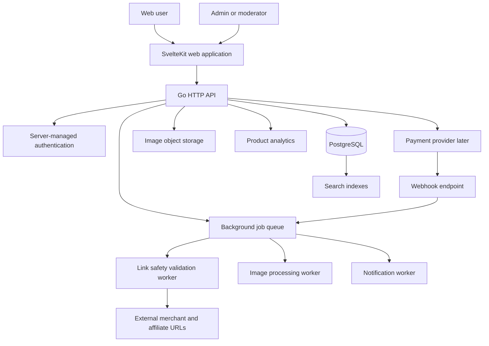

# OoTD Technical Requirements and System Design

**Status:** Draft for MVP planning  
**Related product plan:** [`PRODUCT_PLAN.md`](PRODUCT_PLAN.md)

## 1. Scope and technical goals

OoTD is a creator-first fashion discovery platform. People can publish customizable profiles and OoTD posts; they can optionally tag products and external/affiliate links that pass automated safety validation. Brands cannot create social profiles or publish OoTDs, but can manage a strongly verified product catalog. Styling help can be free, tip-based, or paid. Future phases may support verified live/in-person engagements and a separate pre-loved clothing product.

### MVP goals

1. Let people safely create profiles, customize a limited homepage, and publish image-based OoTD posts.
2. Support discovery through a feed, search, tags, collections, follows, likes, and comments.
3. Let users attach product links after automated safety validation, while using stronger verification for brand-catalog products.
4. Let verified brands contribute products without receiving creator-feed publishing privileges.
5. Establish an architecture that can add payments, styling services, and circular-fashion listings later without rebuilding the core.

### Explicit MVP exclusions

- Merchant checkout, product fulfillment, returns, or shipping handled by OoTD
- Live/in-person styling marketplace payments and scheduling
- Arbitrary custom HTML, CSS, JavaScript, or embedded third-party widgets on profiles
- Automated AI fashion recommendations as a dependency
- Pre-loved selling, swapping, shipping, or donation logistics
- Advertising or pay-to-rank feed placement

---

## 2. Product risks and required decisions

These are not reasons to stop the product. They are important design constraints.

| Risk / flaw | Why it matters | Requirement or mitigation |
|---|---|---|
| Brands are excluded from profiles, but users still need brand information | A catalog-only brand may feel invisible or users may impersonate brands | Create verified `BrandCatalog` pages, product pages, attribution, and an impersonation-report path. Define whether brand employees may post only as personal creators with required affiliation disclosure. |
| Requiring every creator link to be verified creates friction and a large review workload | A manual gate delays posts, but allowing untrusted links enables phishing and affiliate scams | Use automated safety validation for ordinary creator links. Reserve stronger business/domain/product verification and a `Verified brand product` label for catalog products. Recheck, report, and disable links that fail. |
| Affiliate attribution is fragmented | Each merchant and affiliate network tracks referrals differently | Start with outbound-click analytics. Support creator-owned tracking links first. Add network integrations only per merchant/network agreement. |
| Product data becomes stale | Prices, stock, product URLs, and product variants change frequently | Store a `last_verified_at` timestamp, expiration state, product availability status, and periodic catalog refresh jobs. |
| Profile customization and future theme sales can damage usability or safety | Unrestricted MySpace-style customization enables phishing, scripts, slow pages, inaccessible colors, broken mobile layouts, and copyright problems | Use an allowlisted theme token system and prebuilt modules. Never execute user-supplied code. Review public themes for accessibility and rights before any marketplace payout. |
| Styling requests can become unpaid labor | Users or brands can demand too much work for free or pressure creators | Require request scope, allow creators to decline, distinguish free/tip/paid modes, and record agreements before work begins. |
| Live and in-person services create physical safety and liability risks | Meeting strangers, payment disputes, cancellations, and harassment are higher-risk than digital delivery | Defer to a later phase. Require verified organizations/clients, explicit agreement, optional identity checks, safety guidance, clear cancellation terms, and a reporting/escalation workflow. |
| Clothing swaps and giveaways can enable scams or unsafe meetups | Location privacy, counterfeit goods, no-shows, and off-platform payment scams | Defer to a later phase. Start with restricted local pilot rules, no exact address exposure, report/block tools, and verified exchange completion. |
| A social-fashion app has a cold-start problem | A feed with few good posts is not useful; creators will not post without an audience | Launch with a focused creator cohort and selected style communities, then expand access. Seed content only with permission and clear attribution. |
| Creator-first ranking is easy to promise but hard to enforce | Popular creators, affiliate-heavy posts, or brands may dominate naturally | Track distribution metrics: creator concentration, brand concentration, exposure for new creators, save rate, and report rate. Keep ranking rules auditable. |

---

## 3. Chosen MVP technology stack

This stack follows the current preference: **Go + PostgreSQL + SvelteKit**. It keeps the public web experience separate from a dependable, explicit Go API without using a backend-as-a-service as the primary architecture.

| Layer | Choice | Reason |
|---|---|---|
| Web application | **SvelteKit** with Svelte and TypeScript | Server-rendered public profiles/discovery, fast interactive UI, good SEO, and a clean component model |
| API | **Go** using `net/http` and a small router such as `chi` | Standard, explicit HTTP service for browser clients, future mobile apps, webhooks, authorization, and business logic |
| Database | **PostgreSQL** | Relational data fits follows, posts, catalogs, moderation, requests, and payments well |
| Database access | `pgx` with SQL migrations and optionally `sqlc` | Keeps SQL, indexes, transactions, and generated Go types explicit; do not hide core authorization behind client-side database access |
| Authentication | Server-managed cookie sessions implemented by the Go API | Keeps sessions, account recovery, verification, and future role checks under OoTD control |
| Image storage | S3-compatible object storage plus CDN | Outfit imagery is central; store originals privately and serve generated display sizes through a CDN |
| Background work | A dedicated Go worker with a durable PostgreSQL-backed job queue | Handles link checks, image processing, notifications, catalog refreshes, and retryable webhooks |
| Search | PostgreSQL full-text search plus indexed filters for MVP | Enough for creators, tags, styles, occasions, and products; add a dedicated search service only when necessary |
| UI styles | Tailwind CSS or scoped Svelte styles with accessible component primitives | Supports a consistent, responsive design system without forcing a large framework |
| Analytics | Product event analytics plus internal audit/event tables | Measures activation, retention, link clicks, distribution fairness, and moderation outcomes |
| Error monitoring | Structured Go logs and an error-monitoring service | Makes production failures traceable without exposing user data |
| Payments, later | A payment abstraction with a provider verified for the launch country | Do not hardwire the product to a provider before confirming marketplace payouts, KYC, refunds, and Indonesian regulatory support. Indonesian options may include local providers such as Xendit or Midtrans; validate exact marketplace capabilities and current terms before implementation. |
| Deployment | Container-compatible managed hosting with separate preview and production environments | Run the SvelteKit app and Go services as separately deployable containers with clear runtime boundaries |

### Runtime boundaries

- `apps/web` is the SvelteKit public web application. It is the only TypeScript runtime and is responsible for pages, UI, and server rendering.
- `cmd/api` is the Go HTTP API. It owns authentication, authorization, mutations, webhooks, and access to secrets.
- `cmd/worker` is the Go worker process. It runs durable asynchronous jobs and never serves browser traffic.
- Keep browser code untrusted; never put database credentials, payment secrets, or verification-provider credentials in the client.
- The SvelteKit server and browser client call the Go API; they do not query PostgreSQL directly.
- Use a separate worker for retryable and slow operations. Do not make users wait for URL scans, image transforms, or webhook processing.

---

## 4. High-level system design



### Design principles

- **Modular monolith first:** deploy web, API, and worker packages separately only when needed, but keep one codebase, one domain model, and one primary database. Do not begin with independently owned microservices.
- **PostgreSQL is the source of truth:** do not duplicate account, post, catalog, or transaction state into several services.
- **Asynchronous side effects:** verification, notifications, image processing, and payment webhooks run outside the request path.
- **Public pages are server-rendered:** public profiles, posts, tags, and collection pages need SEO, fast previews, and shareable metadata.
- **Every sensitive event is auditable:** permissions, moderation, link state changes, brand verification, and agreements need event records.

---

## 5. Account, role, and authorization model

A single user may have different capabilities, but a role never bypasses moderation or verification requirements.

### Account types

| Account type | Can do | Cannot do |
|---|---|---|
| `person` | Create a profile, publish OoTDs, link products, create collections, request styling, offer styling | Publish as a brand or receive catalog privileges without verification |
| `creator` | All person capabilities plus affiliate analytics and enabled styling services | Bypass link verification, disclosure, or moderation |
| `brand_admin` | Manage a verified brand catalog and products | Create a social profile, publish OoTDs, follow, like, or comment as the brand |
| `moderator` | Review reports, hide content, review links, enforce policy | Access payment secrets or alter payout balances without a separate authorized process |
| `admin` | Manage platform configuration and operational access | Bypass immutable audit logging |

A person who works for a brand may still be a creator as an individual, but affiliation, sponsorship, gifted products, or paid collaborations must be disclosed on relevant posts.

### Authorization requirements

- Enforce ownership and visibility rules in API authorization policies and database transactions.
- Keep PostgreSQL inaccessible from browser clients and the SvelteKit application; all privileged data access goes through the Go API.
- Never trust `user_id`, role, price, verification status, or payment state sent from the browser.
- Require recent authentication or additional verification for sensitive changes such as payout destination, email change, and brand-admin assignment.
- Write audit records for role changes, brand verification, moderation decisions, link approval/rejection, and agreement acceptance.

---

## 6. Core domain model

The following is a logical model; final SQL naming and field types may evolve.

### Identity and profile

- `users`: id, auth_id, username, display_name, bio, avatar_url, account_status, created_at
- `profiles`: user_id, visibility, location_text, pronouns, theme_id, layout_config, profile_version
- `profile_modules`: id, user_id, module_type, sort_order, settings_json, is_visible
- `user_style_tags`: user_id, tag_id
- `follows`: follower_id, followed_user_id, created_at

### Content and discovery

- `outfits`: id, author_id, title, caption, visibility, status, published_at, created_at
- `outfit_media`: id, outfit_id, storage_key, media_type, width, height, alt_text, sort_order, moderation_status
- `tags`: id, type, normalized_name, display_name
- `outfit_tags`: outfit_id, tag_id
- `collections`: id, owner_id, title, description, visibility, cover_media_id
- `collection_items`: collection_id, entity_type, entity_id, sort_order
- `likes`: user_id, outfit_id, created_at
- `comments`: id, outfit_id, author_id, parent_id, body, status, created_at

### Products, brands, and links

- `brands`: id, legal_name, display_name, status, verified_at
- `brand_admins`: brand_id, user_id, role, approved_at
- `products`: id, brand_id, external_product_id, title, description, category, price_amount, currency, product_url, availability, last_verified_at
- `outfit_items`: id, outfit_id, product_id nullable, label, category, position_json, sort_order
- `external_links`: id, owner_id, outfit_item_id nullable, submitted_url, canonical_url, domain, link_type, verification_status, verification_level, checked_at, disabled_at
- `affiliate_attribution`: id, external_link_id, network, merchant, creator_reference, status
- `outbound_clicks`: id, external_link_id, outfit_id, creator_id, anonymous_session_hash, occurred_at

### Services, agreements, and payments (later phase)

- `style_services`: id, creator_id, mode, title, description, price_amount nullable, currency, delivery_type, status
- `styling_requests`: id, requester_id, service_id nullable, creator_id, requirements_json, status, proposed_price_amount nullable, deadline_at
- `service_deliveries`: id, request_id, body, attachment_key, submitted_at
- `service_agreements`: id, request_id, organizer_brand_id nullable, agreement_version, terms_snapshot, accepted_by_requester_at, accepted_by_creator_at
- `tips`: id, request_id nullable, recipient_id, sender_id, amount, currency, status
- `payment_transactions`: id, provider, provider_reference, purpose, amount, currency, status, idempotency_key

### Safety and operations

- `reports`: id, reporter_id, target_type, target_id, reason, notes, status, resolved_by, resolved_at
- `moderation_actions`: id, target_type, target_id, action_type, reason_code, actor_id, created_at
- `verification_reviews`: id, subject_type, subject_id, decision, reviewer_id, reason, created_at
- `audit_events`: id, actor_id, action, target_type, target_id, metadata_json, created_at
- `notifications`: id, recipient_id, type, payload_json, read_at, created_at

### Data-model rules

- Use UUID primary keys.
- Use UTC timestamps everywhere.
- Store money as integer minor units plus ISO currency code; never use floating-point amounts.
- Keep status values as explicit enums/check constraints.
- Soft-delete or preserve moderated records where legally appropriate; do not lose audit evidence.
- Do not expose exact user location by default.

---

## 7. Core workflows

### 7.1 Publish an OoTD

1. Authenticated person uploads images to a restricted upload endpoint.
2. Server validates file size, MIME type, dimensions, and upload rate limits.
3. Images enter processing/moderation state; derivatives are generated asynchronously.
4. User creates outfit metadata, tags, and optional product links.
5. Every new external link enters `pending_safety_check`.
6. The outfit can be saved as a draft. Publication is allowed only when required media checks pass and no attached public link is blocked. A pending link may remain hidden until its automated check completes.
7. A published outfit emits feed-index and notification jobs.

### 7.2 Validate an external or affiliate link

1. User submits a URL and identifies the link type: merchant, affiliate, personal shop, or other allowed destination.
2. Server normalizes the URL and rejects non-HTTPS, private-network, malformed, or disallowed domains.
3. Worker follows a limited number of redirects, checks response status, extracts the final domain, and applies domain and malware/reputation rules.
4. A passing ordinary creator link receives `checked_external_link` status; it is not described as verified or endorsed by OoTD.
5. Human review is reserved for reported/suspicious links and for stronger brand-catalog verification.
6. The link is periodically rechecked. Failed, reported, or changed links are disabled and removed from public click-through.

**Security note:** outbound fetches must block SSRF targets such as localhost, private IP ranges, metadata endpoints, and non-HTTP protocols.

### 7.3 Brand product upload

1. A user requests brand-admin access.
2. Admin verifies the business and the user’s authority to manage its catalog.
3. Brand admin creates/updates products in the catalog.
4. Product URL and availability are verified.
5. Products are searchable and taggable, but do not create social feed posts.
6. Catalog refresh jobs identify stale, missing, or changed products.

### 7.4 Styling request

1. Requester chooses a free, tip-based, or paid creator service.
2. Requester submits the scope, budget (if relevant), deadline, and optional references.
3. Creator accepts, declines, or proposes changes. There is no obligation to accept unpaid work.
4. For paid work, payment authorization and explicit terms are completed before work starts.
5. Creator delivers through the request record.
6. Requester marks delivery accepted, requests a revision within an agreed limit, tips optionally, or opens a dispute.

### 7.5 Live/in-person engagement — future only

1. A verified brand, organizer, or user submits an engagement request.
2. Creator explicitly accepts a standardized agreement with scope, compensation, schedule, location, safety and cancellation terms, and content rights.
3. The system records consent and the accepted terms snapshot.
4. Payment and any travel reimbursement follow agreed milestones.
5. Both sides can report issues; the platform retains agreement and payment audit evidence.

---

## 8. Feed, search, and ranking

### MVP feed strategy

Start simple. Generate a candidate set from:

- Creators the user follows
- Recent public OoTDs matching selected style preferences
- Recent posts from a limited exploration pool of new creators
- Trending posts, measured by saves and meaningful engagement rather than raw likes only

Rank with explainable signals:

- Recency
- Follow relationship
- Match to style/occasion tags
- Save rate and hide/report rate
- Creator diversity
- Brand/product diversity
- New-creator exploration allocation

Do **not** use affiliate commission size as a positive feed-ranking signal.

### Fairness telemetry

Track, review, and set alerts for:

- Percentage of impressions held by the top 1% and top 10% of creators
- Exposure received by creators in their first 30 days
- Brand/product concentration per feed session
- Affiliate-heavy-post share of impressions
- Save rate, hide rate, report rate, and repeat-session rate

### Search requirements

Search must support:

- Usernames and display names
- Style/aesthetic tags
- Occasion, category, season, and budget filters
- Product and brand names
- Indonesian and English text where possible

PostgreSQL full-text search plus normalized tag tables and B-tree/trigram indexes are sufficient for the MVP. Add a dedicated search engine only after query volume, typo tolerance, faceting, or ranking needs exceed this approach.

---

## 9. Profile customization requirements

Profile customization must be expressive without allowing user code execution.

### Allowed

- Approved color tokens with contrast validation
- Approved font pairs and spacing presets
- Header/background images processed through the platform
- Configurable grid layouts from a finite set
- Reorderable, allowlisted profile modules
- External links that pass the same automated safety-validation policy as outfit links

### Not allowed

- User-supplied JavaScript
- Raw HTML embeds or `iframe` embeds in MVP
- Arbitrary custom CSS
- Auto-playing audio/video
- Tracking pixels or third-party scripts

### Storage approach

Store each profile layout as versioned JSON, validated against a server-side schema. Example:

```json
{
  "theme": { "palette": "sunset", "font": "rounded" },
  "modules": [
    { "type": "bio", "order": 1 },
    { "type": "featured_outfits", "order": 2, "settings": { "limit": 6 } },
    { "type": "collections", "order": 3 }
  ]
}
```

The frontend renders only recognized modules and settings. Unknown fields are ignored or rejected.

---

## 10. API and interface requirements

Use the Go API for versioned HTTP endpoints used by SvelteKit, future mobile clients, webhooks, public integrations, and future external consumers. Keep presentation-specific form handling in SvelteKit, but route business mutations through the API.

### Example endpoint groups

| Group | Examples |
|---|---|
| Authentication/profile | `GET /api/v1/profiles/:username`, `PATCH /api/v1/me/profile` |
| OoTDs | `POST /api/v1/outfits`, `GET /api/v1/outfits/:id`, `PATCH /api/v1/outfits/:id` |
| Feed/discovery | `GET /api/v1/feed`, `GET /api/v1/explore`, `GET /api/v1/search` |
| Engagement | `POST /api/v1/outfits/:id/likes`, `POST /api/v1/outfits/:id/comments`, `POST /api/v1/collections` |
| Links | `POST /api/v1/links`, `GET /api/v1/links/:id/safety-status` |
| Brand catalog | `POST /api/v1/brands/:id/products`, `PATCH /api/v1/products/:id` |
| Services, later | `POST /api/v1/styling-requests`, `POST /api/v1/service-agreements/:id/accept` |
| Moderation | `POST /api/v1/reports`, moderator-only review endpoints |
| Webhooks | payment-provider webhook endpoints with signature verification |

### API rules

- Use schema validation on every request and response.
- Paginate all collection endpoints using cursor pagination.
- Rate-limit authentication, uploads, comments, follows, search, link submissions, and reports.
- Use idempotency keys for any payment or state-changing third-party webhook action.
- Return structured error codes suitable for localized UI messages.
- Never expose moderation notes, internal risk scores, or sensitive verification evidence in public API responses.

---

## 11. Security, privacy, and safety requirements

### Authentication and sessions

- Secure HTTP-only session cookies.
- CSRF protection for cookie-authenticated mutations.
- Email verification before public posting or outbound-link submission.
- Optional passkeys / MFA for moderators, brand admins, and payout-enabled creators.
- Login and sensitive-action rate limits.

### Upload security

- Accept only allowlisted image formats for MVP.
- Validate MIME type from file contents, not only the filename.
- Enforce file size and pixel-dimension limits.
- Strip or sanitize metadata where appropriate, especially GPS/EXIF location data.
- Generate display variants server-side; never trust client-provided image URLs.
- Use malware scanning where available before publishing media.

### Privacy

- Privacy-by-default location design: store city/region text only when a user opts in; never reveal exact addresses in profiles.
- Allow users to make profiles, posts, and collections private where supported.
- Provide account export and deletion workflows.
- Define retention schedules for deleted content, reports, payment records, and audit logs according to legal requirements.
- Collect only the sizing/body information needed for voluntary styling requests; it should never be required for ordinary posting.

### Moderation

- User reports for people, outfits, comments, links, catalog products, and service requests.
- Block prevents profiles from discovering, messaging, or engaging with one another as defined by policy.
- Moderation states: `pending`, `published`, `limited`, `hidden`, `removed`, and `appealed`.
- Human-review queue for link disputes, impersonation, counterfeits, harassment, and high-impact account actions.
- Preserve decision/audit history, while minimizing sensitive personal data accessible to moderators.

### Link safety

- Permit only HTTPS public destinations.
- Reject short links unless expanded and verified first.
- Limit redirects and redirect depth.
- Block private IP ranges, localhost, cloud metadata IPs, unusual ports, and unsupported schemes to prevent SSRF.
- Use domain allow/block lists and repeated checks.
- Do not fetch arbitrary URLs from the browser; fetch/scan only in controlled server/worker environments.

---

## 12. Non-functional requirements

Initial targets should be measured in staging and production, then adjusted from actual traffic.

| Area | MVP target |
|---|---|
| Availability | 99.5% monthly availability for core read and write paths |
| Performance | Public profile/feed server response p95 under 500 ms excluding image download; image delivery via CDN |
| Upload UX | Show immediate upload progress; process images asynchronously; keep failed uploads retryable |
| Scalability | Stateless web instances; database indexes and cursor pagination; CDN-delivered media |
| Reliability | Retryable background jobs, idempotent webhooks, dead-letter/failed-job visibility |
| Accessibility | Keyboard navigation, semantic controls, alt text prompts, color contrast validation, responsive mobile layouts |
| Localization | Design text, dates, currencies, and locale rules for Indonesian and English from the beginning |
| Observability | Structured logs, request IDs, error tracking, metrics for queues, uploads, link verification, and moderation |
| Backup/recovery | Automated database backups, tested restore process, object-storage lifecycle/versioning policy |

---

## 13. Environment, deployment, and operations

### Environments

- **Local:** developer environment with local/mock dependencies.
- **Preview:** isolated deployment per change; uses non-production credentials.
- **Staging:** production-like environment for workflow, webhook, and moderation testing.
- **Production:** isolated secrets, database, storage bucket, analytics project, and monitoring.

### Required configuration

- Secrets live in the deployment platform’s secret manager, never in Git or client bundles.
- Use separate credentials and callback URLs per environment.
- Maintain an environment-variable schema and startup validation.
- Restrict database credentials to the Go API and Go worker processes only; neither the SvelteKit server nor browser client connects directly to PostgreSQL.
- Set content-security policy, secure headers, and allowed image domains.

### Operational runbooks

Create short runbooks before launch for:

- A malicious link or phishing report
- Account compromise
- Content takedown or impersonation report
- Payment webhook failure, when payments are introduced
- Product catalog import failure
- Image-processing queue backlog
- Database restoration and incident communication

---

## 14. Testing and quality requirements

### Automated tests

- Unit tests for validators, authorization helpers, money handling, feed selection, and link normalization.
- Integration tests against a test PostgreSQL database for API authorization policies, content visibility, transactions, and role boundaries.
- End-to-end tests for sign-up, publish outfit, save outfit, profile customization, link submission, reporting, and brand catalog upload.
- Security tests for authorization bypass, ID enumeration, SSRF link-safety controls, XSS attempts in captions/profile configuration, and webhook signature validation.

### Manual acceptance tests

- Mobile responsive flow on common low/mid-range devices.
- Slow-network image upload and recovery.
- Keyboard-only navigation and screen-reader review of core flows.
- Indonesian and English text/currency/date layouts.
- Moderator workflow from report through decision and appeal.
- Product/link disablement after a URL changes or fails revalidation.

### Release gates

Do not deploy a feature if it lacks:

- Authorization coverage
- Input validation
- Basic audit events for sensitive changes
- Error monitoring
- A rollback plan or feature flag when the feature has broad user impact

---

## 15. Implementation sequence

### Foundation

1. Initialize a repository with a SvelteKit web app, Go API, Go worker, Docker configuration, linting, formatting, tests, and CI.
2. Create PostgreSQL migrations, role model, Go API authorization policies, and seed data.
3. Implement authentication, username reservation, profile privacy, and basic profile themes.
4. Build safe image upload and processing pipeline.

### Social fashion MVP

5. Implement outfit creation, drafts, publishing, media, tags, and public outfit/profile pages.
6. Implement feed candidates, follows, likes, comments, collections, search, and pagination.
7. Add reporting, blocking, moderation states, audit events, and moderator tools.
8. Add product tags, external-link submission, automated safety-validation queue, click analytics, and public disclosure labels.

### Brand catalog

9. Build brand-verification workflow and strictly separate brand-admin permissions from social publishing.
10. Implement product catalog CRUD, verification status, product pages, and product tagging.
11. Add catalog refresh/revalidation jobs and brand analytics.

### Services and future commerce

12. Add asynchronous free/tip/paid styling requests after payment-provider and legal requirements are confirmed.
13. Add standardized agreements before enabling live/in-person services.
14. Scope any pre-loved listing pilot as a separate product/site only after exchange safety, location privacy, payment, and logistics policies are ready.

---

## 16. Metrics for validating the MVP

### Activation

- Percentage of new users who complete a profile
- Percentage who follow at least five creators or tags
- Percentage who save an OoTD in the first session
- Percentage who publish their first OoTD within seven days

### Engagement and retention

- Weekly active users
- OoTDs published per active creator
- Saves per impression
- Follow conversion from profile visits
- Week 1 and Week 4 retention

### Commerce

- Automated link-check pass/block/manual-review rate
- Product-link click-through rate
- Clicks per creator and per outfit
- Link failure/revalidation rate

### Community health

- Reports per 1,000 views
- Median moderation response time
- Block rate after interactions
- Feed exposure concentration among top creators/brands
- New-creator exposure rate

### Service-marketplace health, later

- Request acceptance rate
- Free/tip/paid service mix
- Completion and dispute rate
- Time to payment/payout
- Repeat requester rate

---

## 17. Open technical decisions

1. **Launch market:** Confirm whether Indonesia is the only initial market. This determines payments, tax, privacy, language, currency, and merchant verification requirements.
2. **Affiliate model:** Decide whether launch supports creator-owned links only, a small approved domain list, or a first affiliate-network integration.
3. **Link safety policy:** Define allowed domains, redirect limits, automatic block rules, recheck interval, and the conditions requiring human review.
4. **Brand verification evidence:** Decide the acceptable documents and ownership proof for brand-admin access and the requirements for a `Verified brand product` label.
5. **Content moderation policy:** Define prohibited content, age requirements, appeal process, and response-time expectations before public launch.
6. **Payment provider:** Select only after confirming local marketplace capabilities, KYC, payout timing, refunds, and fee structure.
7. **Profile modules:** Choose the first set of modules and a maximum count to protect performance and maintain a coherent mobile experience.

---

## 18. Recommended starting architecture

Start with a **SvelteKit web application**, a **Go API**, and a **Go worker**, backed by **PostgreSQL**, S3-compatible image storage, and a durable PostgreSQL-backed job queue.

This gives OoTD:

- A Svelte frontend paired with a stable, explicit Go backend
- Strong relational data and explicit server-side authorization
- Excellent support for image-led social content
- Clear runtime boundaries for links, moderation, and future payment webhooks
- A safe path to add services, payouts, catalog integrations, theme creators, and mobile clients later

Avoid microservices, native apps, in-app merchant checkout, unrestricted profile code, and a complex recommendation engine until user behavior proves they are necessary.
